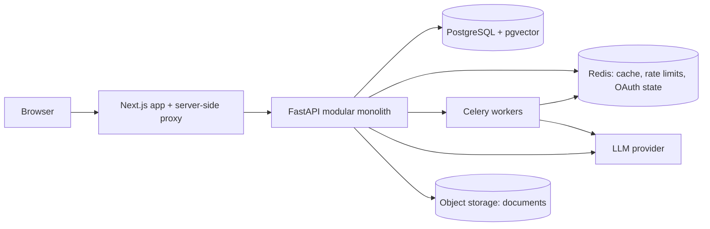

# Complai: AI Workspace for Indian Litigation Lawyers

> **Live:** [complaiindia.tech](https://complaiindia.tech) · Used by hundreds of advocates
> **My role:** Backend engineering intern (architecture, APIs, AI pipeline, auth, AWS deployment)
> **Note:** The source code is proprietary and private. This repository is a technical case study written in my own words, with no company code.

---

## What it is

Complai is a case-centric legal workspace for Indian district-court advocates. Every draft, document, research query and AI interaction belongs to a specific case, so the AI always works with grounded context instead of guessing.

**Core capabilities**

- **AI drafting:** template-driven pleadings (bail applications, written statements, plaints) with an in-editor Co-Pilot that proposes changes for review and never rewrites silently
- **Legal research:** answers grounded in a corpus of 11K+ judgments and 2,000+ statute sections, every claim linked to its source passage
- **Citation verification:** badges such as *Good law*, *Caution* and *Overturned*, derived from how later judgments treated each case
- **Case intake:** upload documents and get the parties, facts and key dates extracted, each quoted word-for-word from the source
- **Chronology:** a case timeline built from uploaded documents, with contradictions between documents flagged for the lawyer
- **Multilingual drafting:** draft or convert pleadings into Indian languages while keeping citations intact

---

## Architecture

| Layer | Technology |
|---|---|
| Frontend | Next.js (App Router), TypeScript, Tailwind, Tiptap editor |
| Backend | Python 3.12, FastAPI, async SQLAlchemy 2.0, Pydantic v2, Alembic |
| Data | PostgreSQL with pgvector, trigram indexes for fuzzy search |
| Async | Celery workers and scheduled jobs on Redis |
| AI | LLM (Claude) with retrieval-augmented generation, BGE-M3 embeddings |
| Auth | Google OAuth/OIDC, JWT access tokens, rotating refresh tokens, Argon2 |
| Infra | AWS (EC2, RDS, S3, ElastiCache), Docker, Parameter Store secrets |
| Quality | 1,000+ automated tests, ruff, mypy (strict typing), pre-commit hooks |

**Design principles**

- **Modular monolith:** 15+ vertical modules, each with its own router, service, repository and schemas. Services depend on interfaces (protocols), so business logic is unit-testable without a database.
- **Grounding over generation:** facts and citations must come from retrieved data, never from the model's memory.
- **The lawyer stays in control:** AI proposes, the lawyer approves. Nothing is written to a case or draft without an explicit action.

---

## Technical deep dives

### 1. Making hallucinated citations structurally impossible

Prompt instructions alone cannot stop an LLM from inventing a case name. Instead, each request builds a **source registry** of retrieved passages, and the model may only cite them by position (`[[src:3]]`). A **validator between the model and the user** checks every marker: a reference to a source that was never retrieved is stripped, logged and retried, and is never shown. Every claim about a judgment is rendered next to the retrieved excerpt it came from.

### 2. Debugging a production sign-in outage

After a migration to AWS, Google sign-in failed in two layers. **First,** the OAuth credentials had never been carried into the new environment, so the provider was silently disabled. I traced it with read-only probes that reported only whether each secret was set, never its value. **Second,** once the credentials were restored, a latent bug surfaced: the ID-token audience check accepted only a list, while Google issues a plain string, as the OIDC spec allows. I fixed the validation, added a test for every audience form, and released the same day.

### 3. Caching and idempotency to avoid redundant LLM calls

LLM calls are slow and cost money, so repeat work is avoided by design:

- **Fingerprint-keyed Redis caching:** results are keyed by a hash of exactly the inputs that matter (for example, the draft and the case record), so reopening a screen never re-calls the model, while a real change to the inputs does.
- **Idempotent background jobs:** document reading and analysis can be retried safely, so a crashed worker never duplicates work or data.
- **Retrieval gate:** if nothing relevant is retrieved, the model is not called at all.

### 4. Search relevance over a 4,000+ template corpus

Lawyers with a criminal case were being recommended unrelated templates. Analysis showed category tags present on **85–95%** of a matter type's templates (for example, "bail" on almost every criminal template), so keyword ranking was effectively random. I filtered out tags too common to carry signal (computed from the corpus, not hard-coded), boosted each practice area's everyday documents, and diversified the results so one category cannot fill the whole row.

### 5. Safe, transactional deletion

Deleting a case originally orphaned its drafts and documents, because most references used `SET NULL`. I mapped every foreign key at every depth from the database catalogue, then rewrote deletion as **one owner-scoped transaction** in dependency order. Stored files are removed **after** the commit, so a storage failure can never undo a database delete, and the LLM audit trail is deliberately kept.

---

## Engineering practices

- **Tests first for every bug:** each fix ships with a regression test that fails without it.
- **Migration-backed test database:** tests run against the real Alembic migrations, so schema drift is caught before production.
- **Audit and privacy by default:** LLM calls are logged with hashes and token counts, never prompt text, with time-based retention.
- **Safe releases:** builds stop before any restart if they fail; secrets live in a managed store, never in the repository.
- **AI-assisted development with review:** I used AI tooling throughout, and validated every change through tests, type checks and code review.

---

## Screenshots

*Add screenshots or a short demo video here (use demo data only).*

| Home | Drafting with Co-Pilot | Citation badges |
|---|---|---|
| `screenshot-1.png` | `screenshot-2.png` | `screenshot-3.png` |

---

## Contact

**Aditya Chopra** · [LinkedIn](#) · [Email](#)
Happy to walk through the architecture and design decisions in detail.
